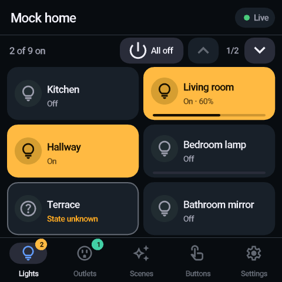
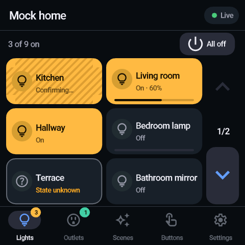
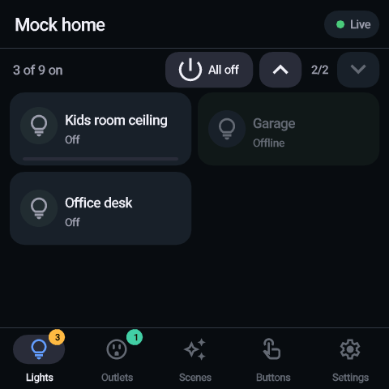
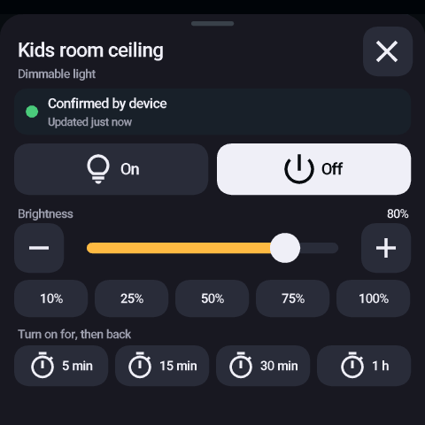
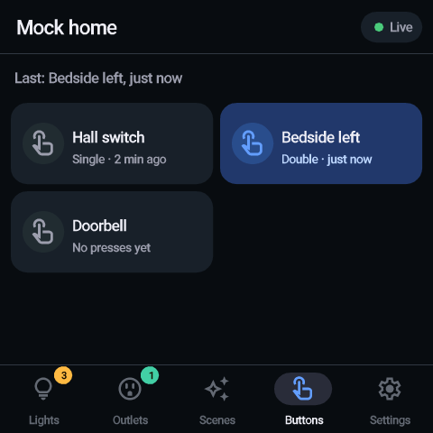
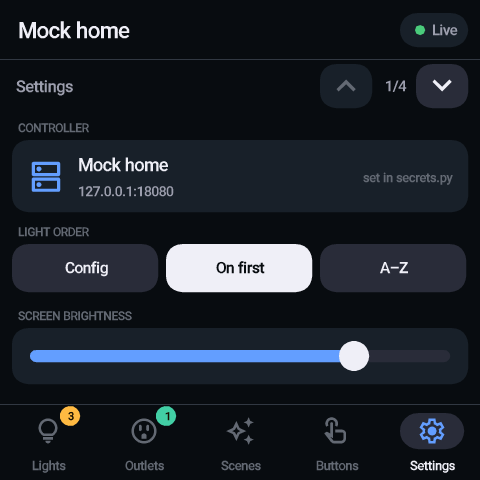
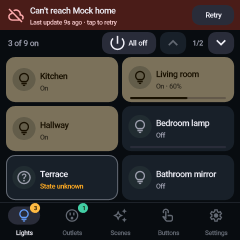
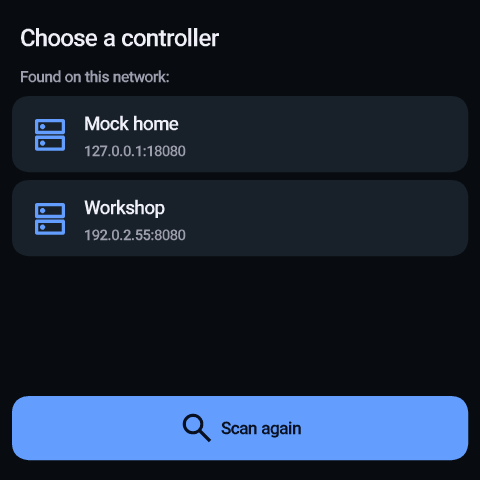

# swkit panel for Pimoroni Presto

A wall-panel UI for [swkit](../README.md) that runs on a
[Pimoroni Presto](https://github.com/pimoroni/presto): a 4" 480×480 touch
screen built around an RP2350 with Wi-Fi. It talks to swkit's control API
over the LAN. You can switch lights and outlets, dim, run timers and step
scenes, and the Buttons page shows wall-switch presses as they happen.

This folder is **not part of the swkit Go binary**. It is a MicroPython app
copied onto the Presto. The only related change on the swkit side is the
optional mDNS announcement described below.

| Lights, screen 1 of 2 | Pending command | Lights, screen 2 of 2 | Detail sheet |
|---|---|---|---|
|  |  |  |  |

| Buttons | Settings | Controller unreachable | Controller picker |
|---|---|---|---|
|  |  |  |  |

The screenshots come from the PC simulator (`sim/`). It runs the same code
and renders with the same font and the same fill rules as PicoVector.

## What it covers

It has the same scope and the same honesty rules as the web control UI
(`/control`, see `server/control_static/control.js`).

| Web control UI | Presto panel |
|---|---|
| Sections: Lights, Outlets, Scenes, Buttons | One section per tab; swipe left/right to change section. Six tiles per screen; longer sections are paged with ▲ 1/2 ▼ or a swipe up/down. |
| Tap to toggle; idempotent `set`, `toggle` only when the state is unknown | Same |
| Requested state shown hatched until a poll *started after* the acknowledgement confirms it; amber "Unconfirmed" after 6 s | Same; the state machine is a direct port (`src/model.py`) |
| Power and brightness as independent, serialized request slots | Same |
| `state_error` shown as unknown, never as off | Same ("?" icon, "State unknown") |
| Page greys out with a banner when polls stop | The header turns red with the age of the data and a Retry button; "on" tiles are muted |
| Long-press: detail sheet with On/Off, brightness, presets, "on/off for" timers, scene stepping, plain-language sync status | Same sheet, sized for fingers |
| Two-tap "All off" per section | Same |
| Button tiles show the last press and when it happened | Same; a fresh press lights the tile blue for 3 s, and optionally flashes the LEDs on the back |
| Display styles (tiles/list/compact), light/dark theme | Not applicable: one layout tuned for the 480×480 panel, dark theme |

Panel-only features:

- **Discovery.** It finds swkit on the LAN over mDNS. A picker appears if
  there is more than one controller. If the controller's IP changes, the
  panel finds it again by name.
- **Wall-panel behaviour.** The screen dims when idle; the first touch only
  wakes it and doesn't switch anything. After 5 minutes idle it returns to
  the first page. It reconnects to Wi-Fi by itself.
- **Back LEDs.** *Status* gives a blue flash on a button press and a slow
  red pulse while the controller is unreachable. *Glow* mirrors the screen
  colours.
- **Light order** (Settings): *Config* (swkit's config order, the default),
  *On first* (lit lights first, then config order) or *A–Z*. With *On
  first*, tiles never move under your finger: the order is refreshed when
  you change section or screen, or after 5 s without touches.
- **Optional tap sound** from the piezo buzzer.
- **On-screen guidance** for every failure: missing `secrets.py`, wrong
  Wi-Fi password, no controller found, controller unreachable.

## Why MicroPython, not C++

Both were evaluated against
[pimoroni/presto](https://github.com/pimoroni/presto) (firmware v2.0.0) and
[presto-boilerplate](https://github.com/pimoroni/presto-boilerplate).

| | MicroPython (chosen) | C++ (pico-sdk, presto-boilerplate) |
|---|---|---|
| Drawing | PicoGraphics and PicoVector are C modules: anti-aliased vector text, shapes and blitting run natively. Python only decides *what* to draw. | Same libraries, called directly |
| Wi-Fi, HTTP, JSON | Built in: EzWiFi, asyncio streams, `json` | Raw lwIP and cyw43; HTTP client, JSON parsing and reconnects are yours to write |
| Touch, LEDs, buzzer | Frozen drivers (`presto.touch`, `set_led_rgb`, `Buzzer`) | No C++ touch driver in the repos; port it yourself |
| Boilerplate state | Official firmware, actively released (v2.0.0, Aug 2026) | Last updated Dec 2024; quits with a blank screen if there's no SD card |
| Iteration | Copy `.py` files over USB, REPL for debugging | Rebuild and reflash a `.uf2` on every change |
| What C++ would add | Raw speed for full-frame animation, LVGL (no Presto port exists) | |

Drawing is the expensive part on this hardware: at full resolution the
framebuffer lives in PSRAM, and every anti-aliased pixel is a
read-modify-write there. So the UI draws as little as possible without
lowering quality:

- **Paging, not scrolling.** A screen flip is one redraw; free scrolling
  needed a full redraw for every finger movement.
- **Per-device repaints.** The model reports which devices changed. A tap or
  poll repaints those tiles, plus the summary bar and tab badges when their
  counts change, each as its own small region.
- **Touch first.** While a finger is down, repaints triggered by polls and
  timers wait.
- **Text-only refreshes.** Ageing text ("2 min ago", "Updated 9s ago") is
  repainted only when it changes.

The app shows its own frame time under *Settings → Last frame*.

**Capability differences on this hardware**

- Rotation is limited to 0° and 180° (ST7701 scan-out).
- Touch is capacitive, two points, but two fingers side by side on the same
  row register badly. The UI uses only single-finger gestures.
- MicroPython has no mDNS service browser. `src/mdns.py` sends a DNS-SD
  "legacy unicast" query (RFC 6762 §6.7), which swkit's responder answers
  directly. Tested against swkit's real responder.
- There is no push channel: the panel polls the control API every 2 s, and
  every 0.5 s while a command is waiting to be confirmed. The web UI does
  the same.

## 1. Prepare swkit

Enable the control API in swkit's `config.json` and let it announce itself:

```json
"WebServer": { "Enabled": true, "Port": 8080 },
"ControlServer": { "Enabled": true, "Advertise": true }
```

`Advertise` publishes `_swkit._tcp` over mDNS, carrying the port and the API
path (`path=/control`). It is off by default. Without it, set `SWKIT_URL`
on the panel instead (step 3).

> The control API has no authentication, the same as the `/control` web
> page. Anyone on the LAN who can reach the port can switch your devices.

## 2. Flash the Presto firmware (once)

1. Download `presto-v2.0.0-micropython.uf2` (or newer) from
   https://github.com/pimoroni/presto/releases/latest. The plain image
   keeps your files. The `-with-filesystem` variant erases them and
   installs Pimoroni's launcher and demos.
2. Connect the Presto over USB-C. Hold **BOOT**, tap **RESET**, and release
   BOOT. A drive called `RP2350` appears.
3. Copy the `.uf2` onto the drive. The Presto reboots by itself.

## 3. Wi-Fi and (optionally) the controller address

```sh
cp src/secrets.example.py src/secrets.py
$EDITOR src/secrets.py
```

```python
WIFI_SSID = "your-network"
WIFI_PASSWORD = "your-password"
SWKIT_URL = ""   # e.g. "http://192.168.1.20:8080/control" to skip discovery
```

`src/secrets.py` is git-ignored. The Presto only has 2.4 GHz Wi-Fi.

## 4. Upload the app

The deploy script uses [mpremote](https://docs.micropython.org/en/latest/reference/mpremote.html):

```sh
pip install mpremote
./deploy.sh                # installs and reboots; the panel starts on boot
```

Options:

```sh
./deploy.sh --launcher     # install as /swkit.py and keep Pimoroni's launcher
                           # (needs the -with-filesystem firmware)
./deploy.sh --mpy          # precompile to .mpy (pip install mpy-cross; same
                           # MicroPython version as the firmware, 1.29 for v2.0.0)
PORT=/dev/ttyACM0 ./deploy.sh   # pick the device when several are connected
DRY_RUN=1 ./deploy.sh      # print the mpremote command without running it
```

What ends up on the Presto:

```
/main.py            entry point (or /swkit.py with --launcher)
/secrets.py         Wi-Fi + optional SWKIT_URL (copied only if src/secrets.py exists)
/swkit/*.py         the app
/swkit/swkit.af     font with icons
/swkit_settings.json   created on the device: chosen controller, brightness, ...
                       (pending changes wait in /ramfs; see "Settings storage" below)
```

**Without mpremote**, use [Thonny](https://thonny.org): pick the Presto's
serial port as a MicroPython interpreter, then use the Files pane. Create a `swkit`
folder on the device and copy everything from `src/` into it, except
`main.py` and the secrets files. Add `assets/swkit.af` to the same folder.
Then copy `src/main.py` and your `secrets.py` to the device root.

**First boot**

1. The panel joins Wi-Fi.
2. It looks for controllers. With exactly one, it connects straight away.
   With several, it shows a picker.
3. It remembers the choice. Use *Settings → Change* to pick another.

To get the Pimoroni launcher back, delete `/main.py` (for example
`mpremote rm :/main.py`) and flash the `-with-filesystem` firmware again.
Note that this erases all files.

## Using it

- **Tap** a tile to switch it. A hatched tile is still waiting for the
  device to report the new state.
- **Long-press** a tile for details: explicit On/Off, brightness slider with
  − / + and presets, "on for 5 min" style timers, scene stepping, and the
  sync status in words.
- **Swipe** sideways or use the tabs to change section. Tab badges count
  what's on. Tapping the active tab goes back to its first screen.
- **▲ 1/2 ▼** next to All off pages through sections with more than six
  tiles; a swipe up/down does the same.
- **Pull the detail sheet down**, tap above it, or tap ✕ to close it.
- **Tap the status pill** (top right), or Retry in the red header, to
  refresh now.
- **All off** asks for a second tap within 3 s.

| Tile look | Meaning |
|---|---|
| Bright fill (amber lights, teal outlets, violet scenes) | On, confirmed by the device |
| Diagonal stripes, "Turning on…" / "Confirming…" | Command sent; the device hasn't reported the new state yet |
| Amber outline, "Unconfirmed" | The device didn't confirm within 6 s; the tile shows what it reports |
| "?" icon, "State unknown" | swkit couldn't read the device; a tap sends a toggle |
| Dimmed, "Offline" | swkit can't reach the device; taps are ignored |
| Blue (Buttons page) | Pressed in the last 3 seconds |
| White outline flash | Just confirmed |

On the Presto, *Settings* holds the controller, *Light order*, screen
brightness, *Dim when idle*, back LEDs (Off / Status / Glow) and tap sound.
It also shows Wi-Fi, IP, the panel's name and the last frame time. The
panel announces itself as `swkit-panel.local`. With *Status*, the back LEDs
stay dark until something needs attention.

### Settings storage

Presto firmware v2.0.0 hangs for good if Python writes to flash while the
display is running. The firmware replaces pico-sdk's core-1 "lockout"
handler with one written for the old SDK protocol: it only answers the
fixed request `0x73a8831e`. The bundled pico-sdk 2.3 sends an incrementing
request id and waits for the echo with no timeout. Writing the settings file
was the "changing Back LEDs / Dim freezes the panel" bug.

So the panel never writes flash at runtime:

1. A settings change applies immediately and is saved to `/ramfs`, the
   firmware's PSRAM RAM disk. It survives a reset, but not a power cut.
2. On the next boot, before the display starts, the RAM copy is written to
   `/swkit_settings.json` in flash.
3. While a change is pending, the panel restarts itself once it has been
   left alone for 10 minutes (screen dimmed, nobody using it), which
   commits it. *Settings → Restart now* does it at once.

Changes made in the last 10 minutes before a power cut are lost.

## Development

```
presto/
  src/          the app (copied to /swkit on the device)
    app.py      boot, Wi-Fi, discovery, polling, LEDs, dimming
    ui.py       layout, rendering, gestures, pages, sheet, settings
    model.py    device state + command/confirmation state machine
    gfx.py      PicoGraphics/PicoVector helpers (text fitting, icons)
    mdns.py     DNS-SD browser (legacy unicast)
    ahttp.py    non-blocking HTTP/1.0 client on asyncio streams
    api.py      control API client
    settings.py persisted panel settings
  assets/       swkit.af font (+ licence notice)
  tools/        make_font.py: rebuilds swkit.af
  sim/          PC simulator, MicroPython check, tests, mock controller
  deploy.sh     upload with mpremote
```

### PC simulator

The simulator runs the unmodified `src/` against fake hardware modules
(`sim/fake/`) and a mock controller. The mock acknowledges commands at
once but reports the new state up to 1.6 s later, like Shelly over MQTT. It
also has an unreadable device, an offline device and button presses.

```sh
pip install pillow numpy
python3 sim/run.py              # scripted tour -> sim/out/*.png
python3 sim/run.py --discover   # controller picker
python3 sim/mock_swkit.py       # just the mock control API on :8080
```

The fakes check arguments the way the C bindings do. For example,
`PicoVector.text()` rejects float coordinates, as the real binding does.

### MicroPython checks

```sh
# unit tests: state machine, settings storage (CPython and MicroPython)
python3 sim/test_model.py
python3 sim/test_settings.py
MICROPYPATH=.frozen:src micropython sim/test_model.py
MICROPYPATH=.frozen:src micropython sim/test_settings.py

# whole app, headless, on the MicroPython unix port: taps through every
# screen, checks that a tap repaints only small regions, paging, light
# order, recovery from an injected UI fault and the boot-time settings commit
python3 sim/mock_swkit.py --port 18081 &
sh sim/mp_check.sh
```

### Font

`assets/swkit.af` contains Roboto Medium (Latin, including Polish) and the
Material Symbols icons the UI uses. To add an icon:

1. Add it to `ICONS` in `tools/make_font.py` and to `ICON` in `src/gfx.py`.
2. Run:

```sh
pip install freetype-py
python3 tools/make_font.py
```

## Troubleshooting

- **"Looking for swkit" finds nothing.** Check that `ControlServer.Advertise`
  is on and swkit was restarted. Some access points filter multicast or
  isolate Wi-Fi clients. In that case set `SWKIT_URL` in `secrets.py`.
- **"Can't join" Wi-Fi.** The Presto supports 2.4 GHz only. Also check the
  SSID and password in `secrets.py`.
- **Blank screen or a message about `swkit.af`.** Re-run `./deploy.sh`; the
  font must be at `/swkit/swkit.af`.
- **Logs and REPL.** Run `mpremote repl` to see the app's prints and any
  traceback. Ctrl-C stops the app; Ctrl-D soft-reboots. An error inside one
  of the app's loops is logged, shown as a toast and the loop restarts;
  repeated errors show the error screen and restart the panel after 20
  seconds.
- **Writing files from your own code.** Don't write to flash while the
  panel runs (see *Settings storage*); stop the app first.

## Status

The app was developed with the PC simulator, the MicroPython unix port
(1.22) and swkit's real mDNS responder. First hardware tests found the
flash-write freeze and slow scrolling described above, which led to
paging and RAM-first settings. Frame times on the RP2350 still need
measuring: check *Settings → Last frame* on the device.
